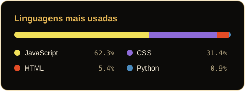

  

## 👋 Sobre mim

Sou o **Eduardo**, analista de sistemas na área de **Processos** e estudante de **Análise e Desenvolvimento de Sistemas**, com formação em análise de dados pela EBAC.

Pego um processo que hoje vive em papel, WhatsApp ou planilha solta e transformo em **sistema, automação ou dashboard** que a equipe usa de verdade. É isso que entrego pela **ECD Tecnologia**.

<table>
<tr>
<td width="33%" valign="top">

### 🧩 Sistemas sob medida
Aplicações web feitas para o processo da empresa, que rodam no computador e no celular.

</td>
<td width="33%" valign="top">

### ⚙️ Automação
Robôs e rotinas que tiram trabalho repetitivo da mão das pessoas.

</td>
<td width="33%" valign="top">

### 📊 Dashboards
Números do negócio organizados para decidir rápido, sem caçar informação.

</td>
</tr>
</table>

## 🚀 Projetos em destaque

<table>
<tr>
<td width="50%" valign="top">

### 💰 [ECD Finanças](https://github.com/Du-Edu-Duarte/ecd-financas)
Fluxo de caixa, contas a pagar e receber, cartões, metas e previsão dos próximos meses para pequenas empresas.

</td>
<td width="50%" valign="top">

### ✍️ [ECD Assina](https://github.com/Du-Edu-Duarte/ecd-assina)
Assinatura digital pelo celular: envia Word ou PDF, marca os campos e manda o link pelo WhatsApp.

</td>
</tr>
<tr>
<td width="50%" valign="top">

### 📄 [ECD PDF](https://github.com/Du-Edu-Duarte/ecd-pdf)
Central de ordens de serviço: importa PDFs em lote, lê os dados sozinho e busca qualquer palavra dentro deles.

</td>
<td width="50%" valign="top">

### 🏃 [Desafio Funcional](https://github.com/Du-Edu-Duarte/desafio-funcional)
App de cronometragem de corrida com largada individual e pódio por categoria. Instala no celular e funciona sem internet.

</td>
</tr>
<tr>
<td colspan="2" valign="top">

### 🤖 [Robô de cadastro automático](https://github.com/Du-Edu-Duarte/Auto)
RPA em Python que lê uma planilha de produtos e preenche o cadastro no sistema sozinho, campo por campo.

</td>
</tr>
</table>

## 🔄 Últimas atualizações

> Esta lista se atualiza sozinha todos os dias por um [GitHub Action](.github/workflows/atualizar-perfil.yml).

<!-- PROJETOS:INICIO -->
| Projeto | O que é | Linguagem | Atualizado |
|---|---|---|---|
| [**ecd-financas**](https://github.com/Du-Edu-Duarte/ecd-financas) · [demo](https://du-edu-duarte.github.io/ecd-financas/) | Fluxo de caixa, contas a pagar e receber, cartões, metas e relatórios para pequenas empresas. | JavaScript | 18 nov 2026 |
| [**ecd-pdf**](https://github.com/Du-Edu-Duarte/ecd-pdf) · [demo](https://du-edu-duarte.github.io/ecd-pdf/) | Central de ordens de serviço e documentos em PDF, com leitura automática e busca. | JavaScript | 18 nov 2026 |
| [**ecd-assina**](https://github.com/Du-Edu-Duarte/ecd-assina) · [demo](https://du-edu-duarte.github.io/ecd-assina/) | Assinatura digital de documentos pelo celular, com PDF assinado e página de verificação. | JavaScript | 18 nov 2026 |
| [**desafio-funcional**](https://github.com/Du-Edu-Duarte/desafio-funcional) · [demo](https://du-edu-duarte.github.io/desafio-funcional/) | App de cronometragem para desafios de corrida e funcional (PWA). | JavaScript | 16 nov 2026 |
| [**Auto**](https://github.com/Du-Edu-Duarte/Auto) | Robô em Python que preenche cadastros a partir de uma planilha (RPA). | Python | 05 nov 2026 |
<!-- PROJETOS:FIM -->

## 🛠️ Tecnologias

  

 

## 🐍 Contribuições

<picture>
  <source media="(prefers-color-scheme: dark)" srcset="https://raw.githubusercontent.com/Du-Edu-Duarte/Du-Edu-Duarte/output/snake-dark.svg" />
  <source media="(prefers-color-scheme: light)" srcset="https://raw.githubusercontent.com/Du-Edu-Duarte/Du-Edu-Duarte/output/snake.svg" />
  
</picture>

---

**Tem um processo que dá trabalho demais?** Me chama: a gente desenha a solução junto.

